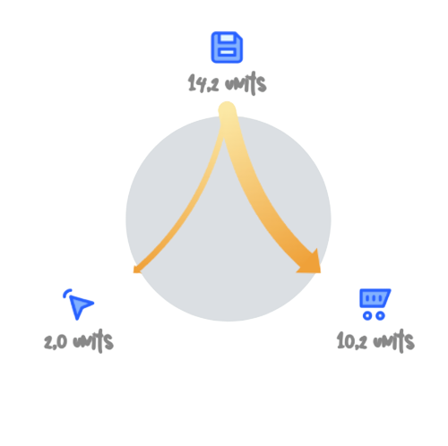
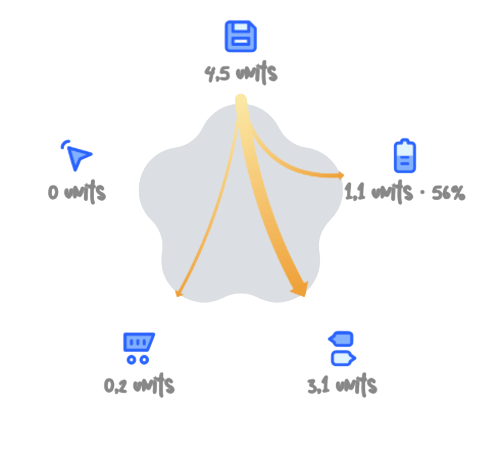

<h1 align="center">StarFlow</h1>

<p align="center">
  A Jetpack Compose graph that arranges icons around a circle or star and connects
  them with animated, gradient flow arrows. Built for energy, network, and
  resource-flow visualizations — plug it into any Android project.
</p>

<p align="center">
  
  
  
  <a href="https://jitpack.io/#mhero/starflow"></a>
</p>

---

## Previews

| Circle | Star |
|---|---|
|  |  |

*(Mockups shown above — real output is drawn live on a Compose `Canvas`, using your own icons and colors. See the [`sample`](sample) module for the running app these were modeled on.)*

## Features

- 🔵⭐ Two background shapes out of the box — `Circle` and `Star` — with any number of vertices.
- 🎯 Icons + two-line labels placed automatically around the shape.
- ➰ Curved, gradient flow arrows between any two icons, with arrowheads.
- 🧩 Small, dependency-light API: three plain data classes + one composable.
- 📦 No app-specific assumptions — icons are passed in as bitmaps, so it drops into any design system.

## Installation

StarFlow is published from this repository via [JitPack](https://jitpack.io).

**1. Add the JitPack repository** in your root `settings.gradle.kts`:

```kotlin
dependencyResolutionManagement {
    repositories {
        google()
        mavenCentral()
        maven { url = uri("https://jitpack.io") }
    }
}
```

**2. Add the dependency** to your module's `build.gradle.kts`:

```kotlin
dependencies {
    implementation("com.github.mhero:starflow:1.0.0")
}
```

> Swap the version for the latest [release tag](../../releases) once you've cut one. JitPack builds a tag on first request, so the first resolve after a new release can take a minute.

Prefer a local, monorepo-style dependency instead? Clone this repo (or add it as a git submodule), then in your `settings.gradle.kts`:

```kotlin
includeBuild("../starflow") // or include(":starflow") if it lives inside your project
```

## Usage

```kotlin
import com.mac.starflow.BackgroundShape
import com.mac.starflow.StarFlowGraph
import com.mac.starflow.bitmapToByteArray
import com.mac.starflow.model.ArrowData
import com.mac.starflow.model.IconData
import com.mac.starflow.model.StarShapeData

@Composable
fun EnergyOverview() {
    val context = LocalContext.current

    StarFlowGraph(
        starShape = StarShapeData(primaryColor = 0xFFDBDFE3.toInt()),
        backgroundShapeType = BackgroundShape.Star,
        icons = listOf(
            IconData(bitmapToByteArray(solarBitmap(context)), "4,2 units"),
            IconData(bitmapToByteArray(batteryBitmap(context)), "1,1 units", "56%"),
            IconData(bitmapToByteArray(homeBitmap(context)), "6,5 units"),
        ),
        arrows = listOf(
            ArrowData(fromTo = 0 to 1, thickness = 15f, colorPair = 0xFFFBE8A5.toInt() to 0xFFEFA139.toInt()),
            ArrowData(fromTo = 0 to 2, thickness = 30f, colorPair = 0xFFFBE8A5.toInt() to 0xFFEFA139.toInt()),
        ),
    )
}
```

- `icons[i]` is a vertex; `ArrowData(fromTo = i to j, ...)` draws a flow arrow from vertex `i` to vertex `j`.
- Icons are plain PNG bytes, so they can come from a vector drawable (see `getScaledIcon`), a network image, or anywhere else — the graph has no opinion on where they came from.

### API at a glance

| Type | Purpose |
|---|---|
| `StarFlowGraph(...)` | The composable. Draws the background shape, icons, labels, and arrows. |
| `StarShapeData(primaryColor)` | Fill color of the background shape. |
| `IconData(icon, primaryText, secondaryText)` | One vertex: icon bytes + up to two lines of label text. |
| `ArrowData(fromTo, thickness, colorPair)` | One flow arrow between two vertex indices. |
| `BackgroundShape` | `Circle` or `Star`. |
| `getScaledIcon(context, drawableRes, targetDp)` | Helper to rasterize a drawable resource to a `Bitmap` at a given size. |
| `bitmapToByteArray(bitmap)` / `byteArrayToImageBitmap(bytes)` | Helpers to convert between `Bitmap` and the `ByteArray` that `IconData` expects. |

Full parameter docs are on `StarFlowGraph` itself (KDoc), and the [`sample`](sample) module has runnable examples for circle and star layouts with 3–6 nodes.

## Project structure

```
starflow/
├── starflow/   # the library module — this is what you depend on
└── sample/     # a small demo app exercising the library
```

## Running the sample

Open the project in Android Studio and run the `sample` configuration, or from the command line:

```bash
./gradlew :sample:installDebug
```

> This repo doesn't ship the Gradle wrapper jar. Run `gradle wrapper` once after cloning (or just open the project in Android Studio, which offers to generate it for you).

## Requirements

- `minSdk` 24+
- JDK 17+ to run Gradle itself (the wrapper is pinned to Gradle 9.1.0 / AGP 8.13.0, which support JDK up to 25)
- Jetpack Compose (BOM `2026.03.01` or newer recommended)

If Android Studio complains that its selected **Gradle JDK** is incompatible, that's a Studio setting, not a project file — go to *Settings → Build, Execution, Deployment → Build Tools → Gradle → Gradle JDK* and pick any bundled JDK 17–25.

## Contributing

Issues and PRs are welcome. Please keep the library module (`:starflow`) free of sample-only concerns — new demo screens belong in `:sample`.

## License

```
Copyright 2026 StarFlow contributors

Licensed under the Apache License, Version 2.0 (the "License");
you may not use this file except in compliance with the License.
You may obtain a copy of the License at

    http://www.apache.org/licenses/LICENSE-2.0

Unless required by applicable law or agreed to in writing, software
distributed under the License is distributed on an "AS IS" BASIS,
WITHOUT WARRANTIES OR CONDITIONS OF ANY KIND, either express or implied.
See the License for the specific language governing permissions and
limitations under the License.
```

See [LICENSE](LICENSE) for the full text.
